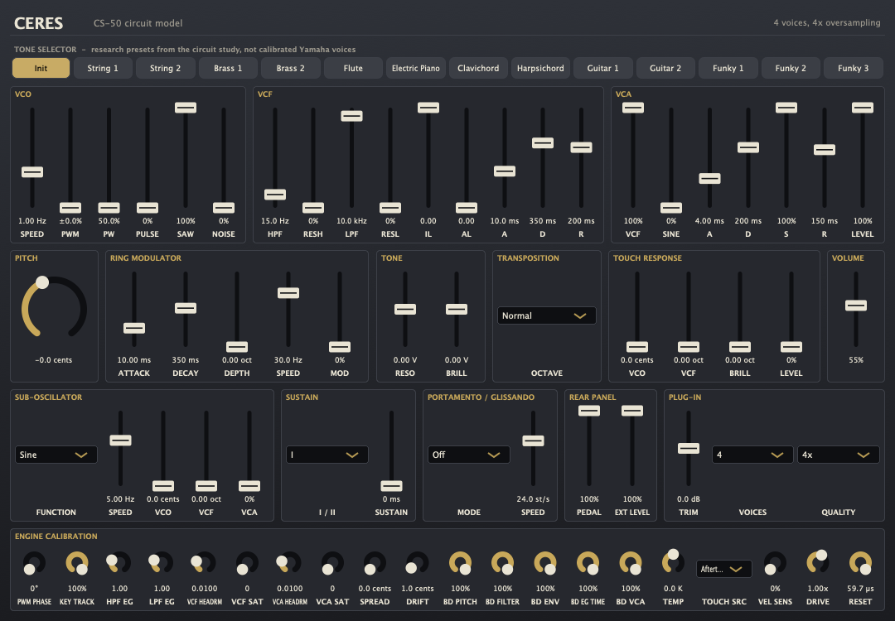

# Ceres

Ceres is a sample-free Yamaha CS-50 research synthesizer: a reusable C++17 circuit engine with configurable 1–16 voice polyphony, and a JUCE VST3/AU/CLAP/Standalone plug-in that plays it, with the circuit study's 14 research presets as its factory programs. The Reason Rack Extension consumes the same DSP through a pinned submodule in its separate adapter repository.



## Audio demos

The CI-generated demos below play **eight of the circuit engine's 14 research presets**, each from a phrase written for its role, without preset edits, gain normalization or external audio. These are also the plug-in's factory programs: the demos drive `ceres::Synth` directly, on the one fixed unit every plug-in instance was before 0.6.4 (seed 20261017), rather than the plug-in's processor. The source phrases are original committed MIDI, not recovered hardware performances; names inherited from the research table do not establish calibrated Yamaha preset matches.

<!-- audio-demos-begin -->

| # | Preset | Demo | Length | Peak |
| --- | --- | --- | --- | --- |
| 1 | Init | [01-init.wav](Docs/audio/01-init.wav) | 10.5 s | -9.5 dBFS |
| 2 | String 1 | [02-string-1.wav](Docs/audio/02-string-1.wav) | 11.2 s | -10.5 dBFS |
| 4 | Brass 1 | [04-brass-1.wav](Docs/audio/04-brass-1.wav) | 10.2 s | -11.9 dBFS |
| 6 | Flute | [06-flute.wav](Docs/audio/06-flute.wav) | 9.7 s | -19.9 dBFS |
| 7 | Electric Piano | [07-electric-piano.wav](Docs/audio/07-electric-piano.wav) | 11.0 s | -7.1 dBFS |
| 8 | Clavichord | [08-clavichord.wav](Docs/audio/08-clavichord.wav) | 11.5 s | -13.2 dBFS |
| 10 | Guitar 1 | [10-guitar-1.wav](Docs/audio/10-guitar-1.wav) | 11.8 s | -13.3 dBFS |
| 12 | Funky 1 | [12-funky-1.wav](Docs/audio/12-funky-1.wav) | 11.5 s | -16.7 dBFS |

<!-- audio-demos-end -->

## Version history

### Unreleased — 1.1.2 — an idle Ceres rests

- A second after every board has gone silent, with the output tail already under 2^-24 (below a 24-bit file's last step), the engine rests: it returns exact silence and only keeps the clocks a later note reads (touch, drift, the SUB and PWM phases, the noise streams, the ring carrier), until a note, a patch change or an EXT IN signal wakes it. Resting costs about 5% of a running engine: on this development container an idle four-voice/1x Ceres took 1.6 ms of CPU per second of audio instead of 30 ms (not a Reason host result). Everything before the rest is bit for bit as before. A note after a rest finds the boards' VCOs and filters where they stopped, as a note played a little earlier would; over 40 seeds its level spread matches the always-running engine's.

### Unreleased — 1.1.1 — lower CPU cost

- Two boards' filters are solved side by side in two-double lanes, and the cutoff rows' diode solver reuses the terms of a step that left its current unchanged. Audio is unchanged: every factory preset at 1, 4 and 16 voices and 1x/2x/4x gives the same double-precision output bits as 1.1.0 (GCC and Clang, with and without FMA contraction), the 439,296-sample CPU regression stream matches byte for byte and the demos re-render identically. On this development container the eight README demos (four voices, 4x, 48 kHz) took 29% less median CPU time, and the factory presets at four voices/1x 31% less; a one-voice configuration, which keeps the scalar solve, is unchanged within noise. Not a Reason host result.

### 1.1.0 — 2026-10-28 — circuit realism

- A new key takes the board whose key went up longest ago, as the key assigner's "old key off" detector does, instead of the quietest one: a long note's tail is now cut before a shorter, younger one. The assigner reads keys, not envelopes.
- The ring MODULATION lever's mid-travel dip follows the expression pedal: 2.35 dB with the pedal open, as before, shrinking as it closes (0.64 dB at a −16.5 dB pedal). Both lever ends and an open pedal are unchanged.
- An overdriven EXT IN signal slews at the preamp op-amp's 1 V/µs, so a clipped square reaches the SUB as a trapezoid. A signal the slew rate does not limit passes bit for bit as before.
- The four boards' cutoffs now lift each other through the shared FH and FL rows: up to 0.1 octave with four boards' filter EGs at +5 V near the lever's floor, 0.009 octave with the lever at 1 V. On the factory presets the change sits at least 62 dB below the signal; a patch with nothing lifting the rows is unchanged. `modulationState()` reports the rows as `hpBus` and `lpBus`.
- Portamento's integrator legs follow the KAS clock trims, 6 Hz at LONG and 6 kHz at SHORT, from the CS-60's alignment of the same board, instead of the CS-50 manual's conflicting figure: up to 54 steps/s a glide runs on the 108.9 ms leg, above that on the 13.6 ms one, and no `glide_rate` reaches the direct gate, so portamento no longer steps. At the default rate of 24 a glide is one smooth curve trailing the counter by about 0.1 s instead of a rippled staircase. Patches with `glide_mode` 1 change; taken on the owner's word after an A/B set ([decision log](Docs/decisions.md)).
- [Sources and measurements](Docs/research/circuit-realism-2026-10-28.md) and [before/after previews](Docs/audio/previews/2026-10-28-circuit-realism/README.md).

### 1.0.5 — 2026-10-23 — built the way the Rack builds it

- Four changes, three exact and one at the last bit, for the Rack's toolchain, which compiles the engine with `-fno-builtin` against its own libc++ and does not auto-vectorise: the audio path's `abs`, `copysign`, `sqrt` and `isfinite` are the builtin forms (library calls there), the decimator history is a mirrored ring read through one window and summed in two vector pairs, and the voice loop's envelope, glide and oscillator calls shed their per-sample overhead. Nothing changes about the sound: the 439,296-sample CPU regression stream is byte-identical to 1.0.4 after every commit, and a one-float-ulp perturbation of any cutoff or resonance on every factory preset stays at least 127 dB below the signal without growing, which is why last-bit arithmetic changes in Ceres can be graded by that null test at all. 1.6% fewer instructions at the Rack's four voices/1x and 4.4% at 4x under clang `-O3 -fno-builtin` on this container; the Rack's own object code, where the library calls are real, is where the first change counts. [Protocol, rankings, probe and validation](Docs/benchmarks/cpu-rack-flags-2026-10-23.md).

### 1.0.4 — 2026-10-23 — a third to a half less CPU, the same samples

- The engine does 38–56% fewer instructions for the same sound (32–54% less median thread CPU on the development container, not a Reason host result): the filters' `tanh` and prewarp `tan`, the PWM clock and the SUB sine are full-precision rationals, the filter solver stops at a 1e-9 Newton step, muted saw and pulse shaping is skipped, the output couplings and the decimator reuse their constants, and the noise source stands idle while NOISE is zero and FUNCTION is off N. The 439,296-sample CPU regression stream is byte-identical to 1.0.3 at the float32 output on every preset, voice count, quality and rate; the engine's internal double arithmetic differs at its last bit. One consequence no null test can grade: when NOISE leaves zero after an idle stretch, the first ~10 ms of noise are a different realisation of the same noise than before. The owner compared it with 1.0.3 by ear and heard no difference, so it ships as chosen by ear ([decision log](Docs/decisions.md)). [Protocol, instruction counts, timings and validation](Docs/benchmarks/cpu-approximations-2026-10-23.md).

### 1.0.3 — 2026-10-23 — first production release

Combines the exact OTA filter warm-start cache with reuse of the final `tanh` result when its argument is bit-identical, and reads the decimator history in two ordered runs. The Newton solver, circuit state, quality modes, latency and preset parameters are preserved. Includes the Rack parity drivers and retained validation history. Rack-specific presets, release packaging and host measurements are maintained in the Rack Extension repository; the earlier development-machine CPU measurements are not Rack performance claims.

### 1.0.2 — 2026-10-23 — exact filter CPU reduction

Reuse the previous sample's exact final `tanh` value at the next filter solve. Core and Rack audio match byte for byte at identical settings; measured SDK-module thread CPU improves by roughly 1–2% median. The circuit solver, quality and latency are unchanged. This version also aligns the canonical project metadata with the Ceres 1.0.2f1 Rack release; its spread and preset trim changes belong to the Rack adapter.

### 1.0.1 — 2026-10-23 — lower CPU cost

- The OTA filters' Newton solver reuses tanh values it has already evaluated, and the output decimator reads its history without a per-tap wrap test. Audio is unchanged: the 439,296-sample CPU regression stream matches the 1.0.0 engine byte for byte (GCC -O2/-O3, Clang -O3). On the 14 factory presets at four voices/4x, 48 kHz, this measured 14% fewer instructions and 13% lower median CPU time on a development machine; not a Reason host result.

### 1.0.0 — 2026-10-23 — first public release preparation

- Prepares the shared engine for the first public Rack Extension release. Retains the 0.6.6 CPU optimizations and circuit sound; the Rack adapter supplies its own factory patch bank and release metadata.

### 0.6.6 — 2026-10-23 — lower CPU cost

- Shares filter setup across voices, reuses unchanged filter/pitch calculations and skips muted sine shaping while retaining its capacitor history. Before/after audio matches byte for byte across 439,296 regression samples. Native benchmarks measured 17.7% lower median CPU for four-voice/4x Init and 10–12% lower mean CPU in the unchanged Rack callback at its four-voice/1x default; these are development-machine measurements, not Reason host results. [Protocol, complete timings and validation](Docs/benchmarks/cpu-efficiency-2026-10-23.md).

### 0.6.5 — 2026-10-22 — the filter's Q pin and the sine's coupling

- RESONANCE is heard as the lever moves: a change of RESONANCE, or of a preset's Q, settles in about 17 ms instead of 1.1 s. The filter chip's Q pin takes current into a low impedance: the CS-30, CS-15 and CS-40M drive it through 22 kΩ into a 390–470 Ω shunt, the CS-50 and CS-80 through a pair of 220 kΩ, and Yamaha prints the same Q at 10 V for both, which only a current input allows. Its 1.72 kΩ is inferred from that; no document prints it. Because a preset's Q row no longer leans on the RESONANCE bus, factory Q rises by up to 10 % (Guitar 2 and Funky 2: 1.44 → 1.58), and the RESONANCE lever law (`resonanceLeverVolts`) sags up to 0.5 V near a third of its travel. The sources decide this; it was not chosen by ear.
- The VCO sine's shaper now hears the triangle through the M board's 4.7 µF coupling into 22 kΩ, which centres it on its own average. That matters where the oscillator's reset plateau makes the triangle lopsided, toward the top of the range: the sine's second harmonic moves by up to 5 dB (C6 on 8': −30 → −27 dB below the fundamental), and after a large jump in pitch the sine re-centres over about 0.3 s. The shaper's curve is still the one chosen by ear in 0.6.0; the coupling comes from the schematic, not from a listen.

### 0.6.4 — 2026-10-21 — every instance is its own unit

- Each new plug-in instance is now a different CS-50: it draws its own random unit, so its boards' pitch, filter, envelope and VCA offsets, oscillator phases and noise differ from every other instance's, within the same service tolerances. Every voice up to `voice_count` is a board of its own, the four physical ones and each further voice alike. A saved session or preset state reopens as the unit it was saved with; a state saved by an earlier version opens as the one fixed unit every instance used to be. The demos keep that fixed unit, so a program sounds like its demo but not sample for sample. The owner asked for this; it was not chosen by ear.
- `voice_spread_cents` is now centred on the voices in use. It was centred only at four voices, so any other voice count was detuned on average: flat below four voices, sharp above. Four voices are unchanged.

### 0.6.3 — 2026-10-21 — the boards part away from their trim point

- The four voices' filter cutoffs now also differ when a filter lever is away from its centre. The boards are matched by ear with each lever at its centre (the CS-60's alignment of the same board), and each filter chip's sensitivity residual, which already spread the envelope, SUB, touch and BRILLIANCE depths, now stretches the lever's own octaves around that point. At the factory settings one instrument's four voices spread by up to about half an octave of the chip's share of the cutoff (Brass 1's high-pass, at the bottom of its lever, anywhere from 68 to 107 Hz at middle C instead of 85 Hz on every voice). A lever at its centre and Q are unchanged, and `board_filter_tolerance` 0 still gives identical voices. The alignment procedure decides this; it was not chosen by ear.

### 0.6.2 — 2026-10-21 — two readings from the CS-80 procedure

- After the last key-up, the ring modulator's DEPTH sweep returns to the SPEED rate over 0.46 s instead of 14.5 s. The CS-80's service procedure aligns the same ring envelope circuit at ATTACK TIME 5 V, which rules out 0.6.0's reading at 10 V; this reverses a choice made by ear in 0.6.0. The panel lever laws for ring ATTACK TIME and DECAY TIME (`ringAttackSeconds`, `ringDecaySeconds`) are 31.6 times faster at every position (attack about 1 ms to 1 s, decay 13.5 ms to 13.5 s T60). The `ring_attack` and `ring_decay` controls are unchanged.
- The output stage clips 0.47 dB lower, and the final 33 µF coupling's corner moves from 0.9 Hz to 1.4 Hz: the HIGH output now drives the 10 kΩ load the CS-80 procedure trims its 0 dBm into, instead of an open terminal. Below the rails the level is unchanged.

### 0.6.1 — 2026-10-21 — every board trim on by default

- The four voices now also differ slightly in envelope timing and VCA balance, by default: each board's attacks, decays and releases sit within its ±5 % EG time trims, and its sine-to-filtered balance within its level trims (`board_envelope_time_tolerance` and `board_vca_tolerance` now 1, were 0). Set both to 0 for the 0.6.0 voices. The owner took both candidates without a listening test, so neither is chosen by ear nor measured.

### 0.6.0 — 2026-10-21 — owner verdicts and hardware laws

- Filter cutoffs follow Yamaha's printed IG00156 law: one octave per volt on both filters and 62.5 Hz at middle C for 0 V, replacing the 0.7/0.65 oct/V estimates. Envelope, SUB, touch and BRILLIANCE depths rescale with it, so the filter envelope sweeps about 1.4 (HP) to 1.5 (LP) times as far. Chosen by ear from the printed candidates.
- Resonance follows its control voltage exponentially between the printed end points, so mid-travel settings are more resonant (Q 1.6 instead of 0.9 at half travel); the end points are unchanged. Chosen by ear.
- Factory presets place their filters as the hardware's loaded preset buses do and assume RESONANCE at MIN. High-pass cutoffs sit 1.3–2.5 octaves higher (String 1 141 → 586 Hz), most low-pass cutoffs 0.2–1.6 octaves lower (Brass 1 2.07 kHz → 890 Hz), and presets that played at the maximum Q 5 now sit near Q 1.4. Presets sound thinner and darker.
- The VCO sine follows the classic transistor triangle-to-sine shaper: about 1.4 % odd harmonics, mostly 5th and 7th, slightly brighter and reedier than a pure sine and 0.3 dB quieter at the same peak. The output reference and clipping rails moved to match. Chosen by ear, not measured.
- The four voices now differ the way four calibrated CS-50 boards do, by default: a cent or two of pitch, most at the bottom of the keyboard, slightly different filter response to envelope, SUB, touch and BRILLIANCE, and envelope depth within the service checks. Each seed is one fixed instrument. Set `board_pitch_tolerance`, `board_filter_tolerance` and `board_envelope_tolerance` to 0 for identical voices. Chosen by ear.
- Free-running pitch drift is on by default: each voice wanders within ±1 cent of its tuning (`drift_cents` 1, was 0), the band the service tuning leaves. Set it to 0 for steady pitch.
- Correction to 0.5.0: the amplitude envelope tolerance applies to the attack peak and the −200 mV floor; every voice holds the same full-sustain level, as the alignment leaves it.
- New opt-in board controls, off by default: `board_envelope_time_tolerance` (attack, decay and release within the ±5 % trim bands), `board_vca_tolerance` (each voice's sine-to-filtered balance within its level trims) and `board_temperature_rise` (−25 to +25 K since tuning; each voice drifts by its own IC temperature rank).
- The ring modulator's wet signal is 3 dB quieter at full MODULATION: its two sidebands now peak at the dry tone's peak. After the last key-up, the DEPTH sweep glides back to the SPEED rate over about 14.5 s instead of 0.47 s. Both chosen by ear.
- Very loud input to the ring modulator compresses and limits as the µA796's input pair does. Four-note chords change by about 1 % at most; touch LEVEL and extra virtual voices reach the limit.
- FUNCTION EXT: the SUB can follow the rear EXT IN jack (`lfo_waveform` 5, `ext_level`), fed per sample by a front end. Existing patches are unchanged.
- Front ends get the PANEL HPF/LPF lever law (`hpfLeverHz`, `lpfLeverHz`): 85 Hz to about 42 kHz at middle C, the first few percent of travel doing nothing.
- The plug-in now plays the circuit engine instead of the silent scaffold. Every engine control is a host parameter, named by its engine key with the engine's range and default; the 14 research presets are its factory programs, Init first; the editor is laid out like the CS-50 panel. Voices (1–16) and oversampling (1×/2×/4×) are plug-in settings applied when the instrument is idle, and the plug-in reports the engine's 31-sample latency. An optional EXT IN input, off by default, feeds FUNCTION EXT (VST3 sidechain, CLAP input port, AU input bus). Sessions saved by the scaffold open as a new instance.
- Plug-in MIDI: velocity, channel pressure as touch, ±2-semitone pitch bend, the damper pedal (CC64), and CC11, which scales the `expression` pedal parameter the way MIDI expression scales volume.
- Research for each component is in `Docs/research/*-authenticity-2026-10-20.md`; the by-ear verdicts behind this version are in [`Docs/decisions.md`](Docs/decisions.md).

### 0.5.0 — 2026-10-20 — component authenticity

- The ring modulator now multiplies by a sine instead of switching a square: the 33k sits in series between the carrier's 100 µF and the multiplier, as the PRA schematic draws it, so the µA796 stays in its linear region. You hear the two sum and difference tones without square-wave sidebands, and slow SPEED settings are no longer up to 38 dB weaker. Some dry signal leaks through, about 5 dB below each sideband, as a typical µA796 does. The wet path now loses lows below about 20 Hz. Wet loudness at full MODULATION is unchanged.
- The output stage no longer squashes loud chords. It is now the PRA board's linear preamp, clipping hard at rails derived from its parts, about 12 dB above the 0 dBm reference. At high VOLUME, chords keep their attack peaks (up to 6 dB more on loud presets); at the default VOLUME 0.55 presets change by at most about 0.5 dB. Full VOLUME with touch LEVEL and tremolo can now exceed digital full scale; there is no limiter, so set the host level with Output Trim.
- The amplitude envelope now sits 2 % of its peak below its target, as the M board is aligned (TP2 at −200 mV with sustain at zero). Releases and zero-sustain decays end in true silence after about four time constants, and a full-sustain note holds at 98 % of its attack peak.
- Factory release CVs now pass the sustain-control transistor follower, as the release levers do on the CS-50, so every preset's release is about 1.7× longer (Brass 1's amp release T60 goes from 0.021 s to 0.035 s). Manual patches are unchanged.
- Factory filter initial levels follow the M-board alignment (−4 V at full IL instead of −5 V), so presets start their filter sweep 20 % less far down.
- Deep pulse-width modulation on upper notes follows the WSC comparator: the pulse cannot get narrower than the oscillator's reset time, so very thin PWM above about 1.7 kHz widens slightly instead of thinning to a needle. The top octave above 5.9 kHz keeps the real reset timing instead of a software clamp.
- New board tolerance controls (`board_pitch_tolerance`, `board_filter_tolerance`, `board_envelope_tolerance`, all off by default) let the four voices differ the way calibrated CS-50 boards do: a cent or two off pitch, most at the bottom of the keyboard; slightly more or less filter response to envelope, SUB, touch and BRILLIANCE; envelope depth within ±10 % and amplitude envelope level within ±2 %. Each seed is one fixed instrument. Existing patches sound exactly as before.
- Front ends get the hardware's panel lever laws: SUB SPEED runs exponentially from 0.8 to 50 Hz, full VCO lever is ±25 cents of vibrato, the VCF lever sags at mid-travel, BRILLIANCE is a B-10K lever from −15 V to +15 V about a grounded centre detent, and RESONANCE runs +10 V at MIN to 0 V at MAX. Saved parameters keep their meaning.
- Research for each component is in `Docs/research/*-authenticity-2026-10-20.md`.

### 0.4.0 — 2026-10-20 — circuit details

- The noise source is now hard-limited, as the CS-50's limiter amplifier makes it: a binary ±1 signal at the waveforms' peak level instead of uniform random values. Audio NOISE is 4.8 dB louder at the same lever setting; its spectrum is unchanged and SUB-N keeps its level. Patches using NOISE change sound.
- The limiter now has a bandwidth, estimated at 14 kHz from the pick-up op-amp's datasheet gain-bandwidth, so NOISE has the same level at every host sample rate. At 48 kHz it is another 4.7 dB louder (9.5 dB above 0.3.0), at 96 kHz 7.7 dB louder. The bandwidth is an estimate; the level moves 3 dB per octave of error in it.
- SUB-N, the noise SUB waveform, now has the hardware's level: the ±15 V limiter through its 22k/0.1µF filter and the 100k load of the SUB buffer. It is about 6.7 dB deeper than before and a little brighter (corner 88 Hz, was 72 Hz). The level rests on an estimated limiter bandwidth from the op-amp's datasheet.
- Tremolo (`tremolo`, the SUB VCA lever) now swings the common VCA around LEVEL by the R7 resistor ratio, ±0.34 of full LEVEL at full lever, instead of dipping up to the whole LEVEL below it. Tremolo patches become shallower and no longer lose average loudness.
- Channel pressure now follows the touch pre-amplifier's 10 ms RC (100k and 0.1 µF), twice the previous 5 ms, so touch swells are slightly softer. Velocity smoothing is unchanged.
- The noise now passes the pick-up amplifier's input coupling (0.047 µF into 100k, a 34 Hz high-pass) before the limiter. NOISE loses most of its sub-bass rumble (about 11 dB less at DC) and SUB-N its slowest wander, which also makes SUB-N 1.3 dB shallower: 5.4 dB deeper than 0.3.0 rather than 6.7 dB.
- The noise limiter now slews: at the op-amp's datasheet 1 V/µs it needs 30 µs to cross between its rails, so short noise spikes turn back before reaching them. NOISE gains about 3.5 dB below 3 kHz while its top falls (−1 dB at 10 kHz, −4 dB at 15 kHz), a fuller, less fizzy hiss, and SUB-N is 4.3 dB deeper (0.77 RMS). Both rest on datasheet-typical slew rate and gain-bandwidth; at 1.7 V/µs the gain would be about 2.5 dB.
- Keys pressed together are stored highest first, as the key coder encodes them: a five-note chord whose notes arrive in the same sample keeps its four highest notes in any MIDI order, instead of the first four received. Sequenced chords of five or more notes keep their top line.
- Portamento now uses the key assigner's own three integrator legs instead of a time constant tied to the glide rate: 109 ms below 1.6 steps/s, 13.6 ms below 43 steps/s, and the direct gate above that, where portamento steps like glissando. At the default `glide_rate` of 24 the glide trails its staircase by a third of a semitone rather than a whole one, so steps are more distinct and the glide arrives sooner. The two thresholds rest on an assumed log-linear counter clock between the printed 11 s and 1.4 ms endpoints.
- The factory presets now reach the engine through the tone-preset boards' diodes. Every preset CV leaves the T71/T72 matrix through a 1S1555, which the guide's printed table does not include, so each pin sits 4.4–5.8 % low. Presets are about 0.5 dB quieter, 12–20 % darker, a little slower in attack and slightly more resonant where the table asked for none. Manual patches are unchanged. The diode's curve is not published, so a 1N4148-class model stands in for it.
- Adds the expression pedal (`expression`), the PRA photo-coupler rather than a volume control. Closing it hands the signal to the 68k–2.2k/0.33 µF leg and the 0.0033 µF at the volume track, so the sound does not just get quieter: fully closed, 65 Hz sits 4.8 dB and 30 Hz 9.7 dB above 1 kHz while 10 kHz falls 6.4 dB below it. Level follows the guide's printed pedal curve, 0 to −40 dB over about 28 degrees. The default of 1 is the hardware's own no-pedal state and bypasses the network exactly, so existing patches are unchanged.
- The two linear panel levers now load their own tracks, as the pots do. `tremolo` is SUB VCA lever travel, which delivers 7.7 % less of the SUB at mid-lever, and `ring_mix` is the MODULATION lever's crossfade, which puts the whole mix 2.35 dB down at mid-lever instead of blending flat. Both ends of each lever are unchanged, so patches at 0 or 1 sound as before. The RESONANCE and BRILLIANCE levers are C-taper pots whose curve is not published, and those controls are defined as bus voltages, so they keep no taper.

### 0.3.0 — 2026-10-20 — hardware realism

- Adds the CS-50's PORTAMENTO/GLISSANDO (`glide_mode`, `glide_rate`): a semitone counter, plus an Hz-domain integrator for portamento, on the key voltage shared by the oscillator and both filters. In Sustain II a released note keeps gliding. Off by default; existing patches are unchanged.
- A repeated key now retriggers its own released voice, as the key assigner does, instead of starting an idle one.
- Touch BRILLIANCE now moves the high-pass a third as far as the low-pass, following the hardware resistor matrix. Touch vibrato is centred slightly above pitch, as Yamaha trimmed it. A new `pressure_wah` adds the hardware's touch-controlled SUB filter route.
- Touch LEVEL (`pressure_volume`) now adds to LEVEL at the common VCA, as the hardware resistor matrix sums them: full touch at full depth adds 1.08 times full `amp_level`, and no touch leaves `amp_level` as set. Patches using it get louder with touch rather than quieter without it.
- A key pressed while every voice is held is ignored, as on the CS-50, instead of stealing the oldest voice. Released and damper-held voices are still reused.
- Patches with nonzero `pressure_filter`, `pressure_vibrato` or `pressure_volume`, or that play more notes than voices, change sound. See the [research write-up](Docs/research/hardware-realism-2026-10-20.md) and the [previews](Docs/audio/previews/2026-10-20-hardware-realism/).

### 0.2.2 — 2026-10-19 — waveform mixing

- Corrects the relative pulse audio polarity so equal-level saw/pulse blends reinforce their fundamentals, following a public hardware-recording comparison. Shared oscillator phase and PWM timing remain unchanged.
- Adds independent mixture regressions and broader rapid-note/envelope checks. The recording supports relative mixing balance; absolute phase, full pulse-width behavior and complete hardware calibration remain unresolved. See the [recording study](Docs/research/accuracy/waveform-mixing-20261019/) and [polarity validation](Docs/validation/waveform-polarity/).
- Changes mixed-source tone and level intentionally; the Rack bank requires new output-trim calibration.

### 0.2.1 — 2026-10-19 — rapid-note continuity

- Smooths velocity expression when an audible voice is reused, avoiding an instantaneous gain or filter-expression jump. Fresh silent notes retain their immediate velocity response.
- Keeps overlapping repeated notes attached to their original key presses after voice stealing, so an older stolen note's key-up cannot release its newer replacement.
- Retains free oscillator phase, envelope and filter capacitor state, keyboard pitch changes and the existing ring model.

### 0.2.0 — 2026-10-19 — configurable polyphony and processing quality

- Adds 1–16 preallocated voices and actual 1×, 2× or 4× internal processing. The standalone default remains four voices at 4×.
- Smooths live Ring Depth edits over 20 ms without restarting the carrier or envelope; saved/static depths start immediately at their configured value.
- Keeps audio-noise density consistent across 1×/2×/4× at the same host sample rate, preserving the original 4× level and the separate SUB-noise path.
- Keeps the existing four-voice, 4× audio byte-identical in the recorded parent comparison. Configuration changes require an unclocked/reset engine; adapters can defer them until idle and fade residual tails.
- Retains nominal 31-host-sample output latency at all qualities. Lower quality trades oversampling headroom and alias rejection for CPU cost; it is not the same sound under a new label.

### 0.1.0 — 2026-10-18 — circuit engine and existing plug-in scaffold

- Adds the tested four-voice oscillator/filter/envelope/ring model and embedded interface alongside the existing plug-in scaffold.
- The README demo renderer now exercises the existing circuit research presets with fixed original MIDI; the separate JUCE plug-in remains unchanged.
- Retains the source-timed VCO conditioning, Q/idle-envelope capacitor continuity and physically scaled ring switching described in the [audible-circuit review](Docs/validation/audible-circuits-2026-10-19/README.md). The hardware-recording comparison remains mixed; this is not a verified full hardware match.

### 0.0.1 — 2026-10-18 — scaffold

- Repository, silent plug-in front end, test tiers and CI set up to the portfolio standard.

## Downloads

<!-- build-download-begin -->
**[Download main build 49](https://github.com/protocodus/virtual-instrument-ceres/actions/runs/40747181113/artifacts/12850435348)**, built from [`aa8e6cf1eba8`](https://github.com/protocodus/virtual-instrument-ceres/commit/aa8e6cf1eba8d4bf8767f288eb8ee27773e0ef02). It holds the macOS, Windows and Linux packages, `SHA256SUMS` and `BUILD.txt`.
<!-- build-download-end -->

---

## How it works

`Source/DSP/ceres.cpp` and `ceres.hpp` implement the circuit engine and its sample-by-sample API, and the JUCE plug-in in `Source/Plugin*` plays it (see [the plug-in](#the-plug-in)). The native and embedded circuit libraries do not depend on JUCE, samples, hardware recordings or manuals at runtime.

The original product version 0.1.0 imported the canonical v0.10.0 research model and subsequent documented circuit changes. It is a reduced circuit model with provisional control calibration, not a transistor-exact recreation. No existing historical validation report is relabelled as a validation of this merged build.

### Use the standalone core


Compile `Source/DSP/ceres.cpp` and include `Source/DSP/ceres.hpp`. For a Rack target define **`CERES_EMBEDDED_TARGET=1` consistently for the core and all consumers** and use C++17. The macro changes `Patch`'s layout, so native and embedded objects must never be mixed across an ABI boundary.

```cpp
#include "ceres.hpp"

// Construct outside the audio callback, once per device/sample-rate lifetime.
ceres::Synth synth(48000.0, 50);
ceres::Patch patch;
ceres::setParameter(patch, "lp_cutoff", 6000.0);
synth.setPatch(patch);
synth.noteOn(60, 1.0);
// Dispatch events at their actual frame before calling process().
for (unsigned frame = 0; frame < 64; ++frame)
    output[frame] = synth.process();
```

`ceres::parameterCount()` and `parameterInfo(i)` describe every key `setParameter` accepts: its range, a default `Patch`'s value and whether the engine rounds it to whole numbers. `getParameter()` reads a key back as the engine applies it. All three are allocation-free and present in both ABIs; the plug-in builds its parameter list from them.

The embedded interface has a numeric `Patch`, a C-string parameter setter, no exception path, and no allocating offline probes/preset APIs. Construction allocates the synth state. Rendering, controller changes, validated patch updates, panic, reset and configuration reuse existing state. Do not construct or replace a synth inside `RenderBatch`.

The output is mono. All configured voices and their capacitor states continue running when no note is held. `activeVoices()==0` does **not** imply silence: the common output bus has a roughly 0.888-second time constant. `allNotesOff()` honors the MIDI pedal; `allSoundOff()` clears audio states while preserving controllers; `reset()` also restores seeded oscillator/controller state. The FIR has nominal group delay 31 host samples, with the decimator's sampling phase affecting event alignment.

### Polyphony and processing quality

`configure(voices, factor)` accepts 1–16 voices and factors 1, 2 or 4. It returns `false` without mutation for invalid values, after processing has started, or when notes are already assigned before the first sample. A request equal to the current configuration is a no-op. `polyphony()` and `oversamplingFactor()` report the applied configuration; the old static constants describe the four-voice, 4× defaults.

Configure before sending notes, or explicitly reset first, then reapply controllers. A changed configuration resets capacitor, oscillator and controller state while retaining the patch. A live adapter should wait for physical keys, pedal and active envelopes to be released, fade the residual tail, reset/configure, restore patch/controllers and fade back in. Panic alone does not reopen configuration. This API does not silently cut held notes or allocate new voices on the audio thread.

The 4× path retains its original 249-tap FIR. The 2× path has a 125-tap FIR with the same nominal group delay; 1× uses an exact 31-sample delay and no redundant low-pass. Final-of-factor sampling retains the legacy fractional decimation phase, so the modes do not promise identical transients. All oscillators, filters, envelopes and circuit states actually run at the selected internal rate. The existing frequency guards operate at that rate, so lower qualities can also limit extreme settings earlier.

Additional voices are a virtual extension of the four-board model. Each is a further board with its own tolerances, drawn from the same bands after the four physical boards, so every voice up to the voice count differs and a board stays the same at every voice count; the PRA's VR6 remains the four physical boards' trim. `voice_spread_cents` steps from board to board, centred on the voices in use. The calibrated common bus and per-voice gain remain unchanged; no voice-count normalization or limiter is added. Larger chords can increase rail saturation and output level. Extra voices use a separate initialization stream; at the default four-voice setting the original shared noise/drift stream remains exact. See [configuration validation](Docs/validation/poly-quality/README.md).

Audio noise is the hard-limited "white noise of constant amplitude" the guide describes (printed p.32), trimmed to the same 3 Vpp as the waveforms. It is the limiter's band-limited input driven into the ±15 V rails, with the bandwidth estimated at 14 kHz from the pick-up op-amp's datasheet gain-bandwidth and the limiter's slew rate at the datasheet's 1 V/µs, simulated at 768 kHz or more so its density is the same at every quality and host sample rate. SUB noise filters the same signal. Different quality settings can still differ through filter discretization, nonlinear processing and alias rejection; this is not hardware gain calibration. See [noise-quality validation](Docs/validation/noise-quality/README.md).

The native renderer accepts `--voices 1..16 --oversampling 1|2|4`, with defaults `4` and `4`. Host adapters may choose and save different defaults independently of the 68 hardware/engineering patch keys.

### Ring, SUB and SUSTAIN controls

| Key | Range | Default | Meaning |
| --- | --- | --- | --- |
| `ring_mix` | 0..1 | 0 | Global dry/wet ring blend |
| `ring_rate` | 0.2..220 Hz | 30 | Base free-running carrier frequency |
| `ring_depth` | 0..8 octaves | 0 | Positive carrier-frequency envelope excursion |
| `ring_attack` | 0.001..10 s | 0.01 | Frequency-envelope time to peak |
| `ring_decay` | 0.01..10 s T60 | 0.35 | Frequency-envelope decay toward the base rate |
| `lfo_waveform` | 0..5 | 0 | Sine, Down, Up, Square, Noise, EXT |
| `ext_level` | 0..1 | 1 | Rear EXT LEVEL: the share of the EXT IN signal that reaches the EXT preamp |
| `sustain_mode` | 1..2 | 1 | I holds released key voltage; II follows the last assigned key |

Live `ring_depth` changes interpolate over 20 ms in the digital control domain. This dezipper preserves the existing exponential frequency law and 220 Hz cap; it is not a newly inferred analog time constant. Startup/reset use the saved depth immediately. Repeated notifications at the same target do not prolong the transition, and a reversal starts from the current interpolated value. The change removes the immediate frequency-control step in a synthetic test; it does not prove the exact cause of a reported host crackle.

The ring envelope triggers when the first physical key is pressed after all keys have been released. Additional held keys do not retrigger it, including a key that finds no free voice. Final key-up returns its frequency envelope toward zero through a fixed release of 0.46 s T60: the PRA holds the release voltage fixed, on an envelope law Yamaha aligns to a 31 ms attack at ATTACK TIME 5 V (the CS-80 procedure for the same circuit); the carrier phase keeps running. The total carrier is bounded at 220 Hz, so SPEED and DEPTH interact near that limit. The multiplier's input pair limits as the µA796's does, on a bus scale taken from the voice-board alignment: four-note chords compress it by at most about 1 %, while touch LEVEL and extra virtual voices push it into its limit. This is a circuit-informed balanced-multiplier model with an envelope alignment taken from the CS-80 and a provisional wet gain.

`ring_mix` is the MODULATION lever's travel. The lever is a 10 kΩ pot whose wiper feeds the expression network, so its own track sags the mix in mid-travel: 2.35 dB down at mid-lever with the pedal open, where the photo-cell ties the network to the VOLUME track (8.04 kΩ). Closing the pedal takes that path away and the load rises toward 67 kΩ, so the sag shrinks: 1.25 dB at a −7 dB pedal, 0.64 dB at −16.5 dB. The cell's resistance is the one the printed pedal curve requires (see `expression`), not a CdS law.

The selected SUB waveform drives VCO, VCF, VCA and pressure vibrato. Noise uses the documented 22k/0.1µF low-pass and a fixed engineering level; it is independent of SUB rate and audio Noise mix. PWM retains its separate sine oscillator.

FUNCTION EXT (`lfo_waveform` 5) takes the SUB signal from the rear EXT IN jack instead, through the same routes. A front end feeds one sample per host frame with `Synth::externalInput()` before each `process()`. One unit is 1.5 V/101, about 14.9 mV at the jack: the ×101 EXT preamp lifts it to the internal waveforms' 1.5 V peak, so a ±1 signal at `ext_level` 1 modulates as deeply as the internal SUB. The preamp's 10 µF output capacitor high-passes the signal at 0.32 Hz while EXT is selected and keeps its charge when FUNCTION moves away (0.16 Hz there). The preamp and the SUI buffer clip at their datasheet-typical swings, 9.33 and 8.67 units, and the preamp slews at its op-amp's datasheet-typical 1 V/µs, so an overdriven input, the usual case at ×101, reaches SUI with 28 µs edges rather than a square's; both are estimates. The LEVEL pot's taper is not published, so `ext_level` is its wiper ratio rather than its travel. The internal waveforms ignore the jack, and EXT with nothing fed is a silent SUB. See [the SUB research note](Docs/research/sub-authenticity-2026-10-20.md).

In Sustain II, released/free boards follow the last assigned key in both oscillator pitch and filter tracking. Their envelope charge, gates, oscillator phase and filter state remain continuous. Entering II applies this immediately; returning to I captures the current key voltage. MIDI-damper-held boards remain protected until pedal-up, an explicit software adaptation rather than recovered Yamaha allocation behavior. This selector is distinct from `global_release` and MIDI damper gating.

The ring/SUB/Sustain additions preserved the earlier audio path in their recorded same-build regression. The subsequent unequal SUB filter route intentionally changes nonzero `filter_lfo` patches. Controls and circuit uncertainties are detailed in [DSP_SOURCE.md](Docs/research/dsp-source.md).

### Global sound-path controls

| Key | Range | Default | Meaning |
| --- | --- | --- | --- |
| `brilliance` | −15..+15 V | 0 | Loaded shared BR-node offset; different HP/LP cutoff gains |
| `resonance_offset` | −10..+10 V | 0 | Shared RES-node voltage change; positive lowers Q, with a 17 ms RC response (the Q pin's input inferred) |
| `amp_level` | 0..1 | 1 | Common filtered+sine VCA level before amp EG, bus and ring |
| `output_trim_db` | −24..+24 dB | 0 | Utility gain after all circuit processing and FIR, for saved preset calibration |

The first two controls use an explicitly anchored stiff-source model, not recovered passive-pot positions. The signed resonance offset is an engineering delta around existing effective Q settings; the actual hardware wiper is 0..10 V, and factory presets assume the RESONANCE lever at MIN (+10 V), so from them it reaches 0 to −10 V. Its capacitor state survives note/preset changes and audio panic. SUB filter depth remains the LP depth; HP gets 47k/150k, about 0.313 times as much modulation. Common VCA level adds to the existing SUB-amplitude control and closes at zero, rather than multiplying two gain controls. Factory LEVEL now drives that common VCA instead of final master volume.

Neutral offsets, common level 1 and output trim 0 preserve the prior paths when the intentionally corrected SUB filter route is inactive. The output trim is a modern linear utility, not part of the analog model; it adds no limiter and cannot promise a fixed peak under arbitrary MIDI. The [source audit](Docs/research/sound-path-gap-audit-2026-10-18.md) distinguishes known resistor/capacitor relationships from provisional control calibration.

The four boards' cutoffs share the FH and FL rows. A board's VCF EG, touch, SUB and BRILLIANCE lift its filter chip's control node, which then draws less from the row through its 39k, so the row and every board's cutoff rise a little; `modulationState()` reports the rise as `hpBus` and `lpBus`. Near the PANEL lever's floor, four boards at +5 V of LP EG raise each other's cutoff by 0.1 octave; higher up the lever's diode holds the row, to 0.009 octave with the lever at 1 V. The rows always carry the four physical boards, idle ones at their EG's initial level, at any voice count; further voices follow the rows without loading them. With nothing lifting them the cutoffs are exactly the patch's.

### Portamento, glissando and the key assigner

| Key | Range | Default | Meaning |
| --- | --- | --- | --- |
| `glide_mode` | 0..2 | 0 | Off, Portamento, Glissando |
| `glide_rate` | 1..200 semitones/s | 24 | Glissando counter clock |

The CS-50 builds each board's key voltage in the KAS board (Servicing Guide printed pp.22–25). The assigner's key code passes a glissando counter, an integrating gate and a sample-hold, then reaches the VCO and both filters. Ceres follows that order. The counter steps one semitone at a time toward the board's assigner key at `glide_rate`. Glissando sends each step straight on. Portamento integrates the stepped key voltage through the gate the lever's comparators select (printed p.25): the 3.3 MΩ into 0.033 µF, 108.9 ms, below 54 steps/s, and 470 kΩ‖3.3 MΩ, 13.6 ms, up to `glide_rate`'s top of 200. The direct gate, where portamento would step like glissando, lies beyond that. The key voltage is linear in Hz, so the glide approaches its target exponentially in Hz rather than in pitch.

Free channels carry the last-pressed key, so a newly assigned board glides from the previous key. While its key is down, or in Sustain II, the sample-hold follows the glide. In Sustain I it freezes the pitch at key-off. The comparator thresholds sit on a counter clock taken as log-linear across the lever between the KAS board's trims, 6 Hz at LONG and 6 kHz at SHORT. Those trims are the CS-60's alignment of the same board (sibling evidence), taken over the CS-50 manual's conflicting 11 s to 1.4 ms on the owner's word ([decision log](Docs/decisions.md)). The law between them is not printed, so `glide_rate` is the clock rate, not a lever position.

The assigner only writes a new key into a channel whose code differs from that key and whose key is up (guide pp.17–18). A released board that still holds the pressed key is therefore re-keyed first, then the free board whose key went up longest ago (boards not yet played count as oldest, in board order), then the oldest damper-held board (its key is up). The assigner sees keys only, never an envelope, so a board still sounding its release is as free as a silent one: the chip's block diagram names an "Old Key OFF CH Detector" (IC Guide, YM26600) and the guide's p.19 chart gives the next key to the channel released first. A key pressed while every board's key is down is not stored (guide p.19 timing chart): it does not sound, and it does not start later when a board frees. Keys pressed together are encoded higher note first (guide p.16), so a key arriving in the same sample as a lower stored key takes that key's board: a simultaneous five-note chord keeps its four highest notes, whatever order the MIDI events arrive in.

### Velocity expression

`expression_source` selects **0 = channel aftertouch** (the legacy default) or **1 = note-on velocity**. Values clamp to 0..1 and round to the nearest integer. The existing `pressure_volume`, `pressure_filter` and `pressure_vibrato` depths then use the selected source. This optional velocity mode is a modern DAW mapping, not a claim about the original hardware.

Velocity is latched independently for each allocated voice and stays with its release tail, including during Sustain II pitch following. A new note assignment or repeated-note retrigger stores the incoming velocity only on that board. When the board is still audible, its consumed velocity approaches the new target using the existing 5 ms digital expression RC; silent and zero-envelope assignments precharge immediately. This avoids a gain/filter-expression step without adding keyboard glide or resetting oscillator, envelope or filter state. Channel pressure has no audible effect in velocity mode; switching back uses its continuously smoothed history. Live source changes preserve oscillator/envelope/filter state and may change the expression gain immediately.

Each physical note press also retains a FIFO identity, including a press that found no free board. Its eventual key-up consumes that press alone; it never releases a board another press owns. These velocity and MIDI ownership policies are software adaptations, not recovered CS-50 keyboard circuitry. See [the rapid-note validation](Docs/validation/note-reuse/README.md).

Touch LEVEL adds to the common VCA gain: `amp_level + 1.08*pressure_volume*expression`. R7 sums LEVEL (10 V full, 270k) and touch LEVEL (calibrated to 6.0 V full, 150k) into the same node, so (6/150k)/(10/270k) = 1.08 (service manual 1 p.14; guide p.55). The VCA's headroom above full LEVEL is not documented, so full touch on a full-LEVEL patch may drive the output rail harder. Filter expression is touch BRILLIANCE: `expression*pressure_filter` octaves on the low-pass variable conductance above its fixed resistor floor, and 47/150, about 0.313 times that, on the high-pass. The R7 matrix feeds TBR through 47k to LP and 150k to HP, the same split as SUB. `pressure_wah` scales the selected SUB waveform by touch into the same two nodes: `expression*SUB*pressure_wah` LP octaves, the hardware's level amplifier II → R7 VCF route. Vibrato adds `expression*pressure_vibrato*(SUB + 1/3)` cents. Yamaha trims level amplifier I so the 3 Vpp SUB leaves centred on +0.5 V (guide p.56), so touch vibrato bends slightly upward on average. The 1/3 offset assumes that centring scales with the touch gain. The separate native `velocity_sensitivity` gain remains multiplicative with that sum. All native research presets retain source 0. Hosts should default missing saved properties to 0 to preserve old patches, and explicitly save 1 for velocity-oriented patches.

### The plug-in

The JUCE processor (`Source/PluginProcessor.*`) runs one `ceres::Synth` per instance. Every engine key is a host parameter whose ID is the key itself (`lp_cutoff`, `amp_release`, …, JUCE version hint 1), with the range, default and whole-number flag the engine's descriptors report, so the plug-in keeps no second copy of the table. `Source/PluginControls.h` adds only presentation: names, panel captions, units, groups and a linear, logarithmic or centred travel. A key it does not list still appears, under Engine. Whole-number keys and switch positions (`octave`, `lfo_waveform`, `sustain_mode`, `glide_mode`, `expression_source`) are choices. Parameter IDs never change once released. The levers move the engine's own quantities; they do not follow the panel lever laws the engine offers front ends (`subSpeedLeverHz`, `hpfLeverHz` and the rest), whose travel covers only part of each key's range.

Two plug-in settings sit beside them and are not automatable: `voice_count` (1–16, default 4) and `oversampling` (1×, 2× or 4×, default 4×). The engine can only be reconfigured idle, so a change made while anything sounds waits until no key or damper pedal is held and no voice is active, fades the remaining tail out over 20 ms, resets and reconfigures the engine, restores the patch, bend, pressure and pedal, and fades back in. A key or the pedal arriving during the fade-out cancels it. `prepareToPlay` applies the settings at once. The plug-in reports the engine's 31-sample latency at every quality, and a tail of 0.73 times the longer of `amp_release` and `global_release` plus 6.1 s: the slowest VCA EG release at the widest board tolerance, then the output bus's 0.888 s coupling capacitor falling 60 dB. The engine runs at 8–384 kHz; at any other rate the plug-in stays silent and the editor says so.

MIDI events take effect at their own sample, on any channel. Velocity reaches `noteOn()` as velocity/127, channel pressure is the touch response (`pressure()`), pitch bend spans ±2 semitones and the damper pedal (CC64, on from 64) drives `sustain()`. CC11 scales the `expression` pedal parameter, the way General MIDI expression scales channel volume: the parameter sets where a fully raised MIDI pedal sits, and until CC11 arrives (or at 127) the parameter alone sets the pedal. Neither writes the other, so automation of the pedal and a played CC11 never fight, and the parameter's default of 1 stays the hardware's no-pedal bypass. CC120 silences, CC123 releases every key (the damper still holds what it holds) and CC121 resets bend, pressure, the damper and CC11. Other controllers, polyphonic aftertouch and program changes do nothing.

The output is mono, on both channels of a stereo output. An optional **EXT IN** input bus, off by default, feeds the rear EXT IN jack through `Synth::externalInput()` on every frame, unscaled (one unit is 1.5 V/101 at the jack), from its first channel if the host gives it two; disabled or absent, the jack reads silence. FUNCTION EXT (`lfo_waveform` 5) and `ext_level` decide what it does. VST3 offers it as an auxiliary (sidechain) input, CLAP as a non-main input port and AU as an input bus, which the wrapper fills with silence when nothing is connected. The Standalone keeps it off, so it never opens an audio input.

The factory programs are the 14 research presets, Init first and the one a new instance opens on. Choosing one sets every engine key except `expression`, `ext_level` and `output_trim_db`, which stay where the player or host set them. Parameters hold floats, so a program's values match its preset to float precision. Each instance is its own unit: a new instance draws the engine seed at random, which sets each board's tolerances, oscillator phases and noise, so a program sounds like its demo but not sample for sample. The saved state is the parameter tree with a format version, the current program, the plug-in version and the unit, so a saved session reopens as the same unit; restoring a different unit while the engine runs rebuilds it, which silences what was sounding. A state saved before 0.6.4 names no unit and opens as the fixed one every earlier instance was, the demos' seed 20261017. A parameter the state does not mention takes its default, and a state saved by the earlier silent scaffold opens as a new instance and keeps the instance's unit.

The editor (1080×750) is laid out like the CS-50 panel: the tone-selector tablets, then the VCO, VCF and VCA levers, PITCH, RING MODULATOR, TONE, TRANSPOSITION, TOUCH RESPONSE and VOLUME, then SUB-OSCILLATOR, SUSTAIN, PORTAMENTO / GLISSANDO, the rear panel and the plug-in settings, with the engine calibration controls as knobs along the bottom. Its sections come from the processor's parameter groups, so it shows exactly the parameters the host sees.


## Known gaps

- No host has yet exercised the plug-in's EXT IN as a sidechain input, and the AU's handling of it is untested. The factory programs are research presets from the circuit study, not calibrated Yamaha voices.
- A unit can be neither seen nor chosen; only a saved state brings one back. Sixteen voices at 4× can need more than a whole CPU core at 48 kHz; `voice_count` and `oversampling` trade CPU for polyphony and alias rejection.
- Factory control-voltage calibration, source impedances, some chip loading/nonlinearities and absolute ring wet gain remain uncertain. The ring envelope's alignment voltage and the output level meter's load come from the CS-80's procedure for the same circuits; no CS-50 document states them. The RESONANCE controls' 17 ms lag and the Q buses' loads take the filter chip's resonance pin as a 1.72 kΩ current input: the CS-30, CS-15 and CS-40M boards for the same chip show that it takes current, but its input resistance is inferred, not printed. See [DSP source and model limits](Docs/research/dsp-source.md) and the [audible circuit evidence](Docs/validation/audible-circuits-2026-10-19/README.md).
- Historical research reports bind their original sources and may reference external working directories or source recordings. They are retained provenance, not portable current-CI results.
- EXT IN's host-rate signal is interpolated linearly inside the oversampled engine; the op-amp swings and the preamp's slew rate are datasheet typicals, and the preamp's 29.7 kHz closed-loop bandwidth is not modelled (under 0.5 dB at 10 kHz). Optional velocity and MIDI-pedal behavior are explicitly modern adaptations.
- The cutoff rows are solved behind the PANEL lever's follower and diode. A patch does not say whether a tablet set its cutoff, and a tablet's column couples the boards more: 0.07–0.09 octave with four boards at +5 V of LP EG on the weaker columns.
- The portamento clock is taken as log-linear between the CS-60's LONG and SHORT trims, and `glide_rate` covers 1–200 steps/s of the lever's 6 Hz–6 kHz. The noise limiter's bandwidth and slew rate are not calibrated.

## Build

CMake 3.22+, a C++17/20 compiler and Python3 are required for the full unit suite. The circuit targets explicitly compile as C++17; the JUCE plug-in uses C++20. Build the standalone DSP without JUCE:

```sh
cmake -S . -B build-dsp -DCMAKE_BUILD_TYPE=Release -DCERES_BUILD_PLUGIN=OFF -DBUILD_TESTING=ON
cmake --build build-dsp --parallel
ctest --test-dir build-dsp -L '^unit$' --output-on-failure
./build-dsp/ceres_render --events Tools/init.events.tsv --preset init \
  --rate 48000 --frames 288000 --seed 50 --output /tmp/ceres-init.wav
```

`ceres_native` and `ceres_embedded` are the circuit libraries. `ceres_render` writes mono float32 WAV without normalization; sorted event rows are `frame type note value`. It supports note-on/off, bend, pressure, pedal, all-notes-off, panic and reset. `--patch path` reads key=value overrides and `--build-info` reports the exact compiled sources including the merged CMake file. The native research preset API is excluded from the embedded ABI.

The circuit checks cover oscillator/filter/envelope/ring contracts, expression, all 68 keys and their descriptors, the EXT IN feed with zero post-construction allocations, and native/embedded parity. They are named `Ceres.<Suite>` and labelled `unit`; `CeresDSPCxx17` compiles `ceres.cpp` as the Rack does (C++17, `CERES_EMBEDDED_TARGET`, no exceptions). Test executables are resolved by CMake target paths for single- and multi-configuration generators. The `audio`, `render` and `fuzz` tiers remain separate; the unchanged audio contract now renders the actual circuit preset list twice.

```sh
ctest --test-dir build-dsp -L '^audio$' --output-on-failure
./build-dsp/RenderCeresPresetDemos --jobs 4 Docs/audio/midi build-dsp/demo-audio
```

The demo tool uses the shared fixed 48 kHz/256-frame/seed protocol and the original MIDI phrases written by [`Tools/write_preset_midi.py`](Tools/write_preset_midi.py). It duplicates the mono engine into two identical channels without gain changes. Every raw render must be finite, audible, below 0 dBFS, 8–12 s long and identical on repetition, and is written as a 48 kHz 24-bit WAV; no captured sound or preset-specific level adjustment is involved. Historical empty-bank failure evidence remains frozen in the [initial integration report](Docs/validation/main-integration-2026-10-19/report.json); the subsequent [demo integration validation](Docs/validation/research-demos-2026-10-19/report.json) records the resolved audio path and its new build identity.

```sh
cmake -S . -B build-sanitize -DCMAKE_BUILD_TYPE=Debug -DCERES_BUILD_PLUGIN=OFF -DCERES_SANITIZE=ON
cmake --build build-sanitize --parallel
ASAN_OPTIONS=detect_leaks=0 ctest --test-dir build-sanitize -L '^unit$' --output-on-failure
```

`CERES_SANITIZE` is a compatibility alias for the existing `CERES_ENABLE_SANITIZERS`; either instruments development targets with ASan/UBSan. `CERES_BUILD_TOOLS=OFF` excludes both renderer tools without dropping core tests. `Ceres.DspFuzzReplay` (`unit`) feeds `ceres::Synth` the fixed crashes committed in `Tests/Fixtures/fuzz/` and then seeded malformed input; `CERES_BUILD_FUZZER` (Clang) adds `Ceres.DspFuzz` (`fuzz`), the same harness as a two-minute libFuzzer run.

`Ceres.CpuBudget` (`perf`, Release builds without sanitizers) times every demo on one thread after a warm-up and fails when a median exceeds the budget in `Tools/RenderPresetDemos.cpp`; `./build-dsp/RenderCeresPresetDemos --cpu --json cpu.json Docs/audio/midi` prints the realtime factors. They are development-machine figures, not Reason or DAW CPU.

The separate plug-in build fetches pinned JUCE 8.0.14 and clap-juce-extensions unless `CERES_JUCE_PATH` and `CERES_CLAP_JUCE_EXTENSIONS_PATH` point to local checkouts. `CERES_BUILD_CLAP` controls the CLAP wrapper; on macOS `CERES_BUILD_UNIVERSAL` defaults to ON. Linux dependencies are listed in `.github/workflows/ci.yml`.

```sh
cmake -S . -B build-plugin -DCMAKE_BUILD_TYPE=Release -DCERES_BUILD_PLUGIN=ON -DBUILD_TESTING=ON
cmake --build build-plugin --parallel
ctest --test-dir build-plugin -L '^unit$' --output-on-failure
# Full suite also includes circuit audio, editor rendering and fuzz tiers:
ctest --test-dir build-plugin --output-on-failure
```

It builds the VST3, CLAP and Standalone, and the AU on macOS. `Ceres.PluginProcessor` (`unit`) checks the parameters against the engine's descriptors, the programs, state round trips, rendering bit for bit against a directly driven `ceres::Synth`, EXT IN, the bus layouts, unsupported sample rates, deferred reconfiguration and the editor. `Ceres.ParameterMatrix` (`fuzz`) plays a fixed 1/50 sample (`--shard 0/50`, shards numbered from 0) of the portfolio's parameter-extremes matrix. Its ceiling is the output stage's own bound, the rail span through the decimation filter and the trim, and silence is due by the tail the processor reports plus the bus capacitor's time to bring the largest output the stage allows down to full scale. The main build runs every case at all nine rates and block sizes in 16 shards, and `scripts/validate-plugins.sh` runs pluginval, clap-validator and auval on the built plug-ins. `Ceres.EditorRender` (`render`) renders the editor screenshot and compares its size with the committed one only while the editor source is the one that rendered it, which the PNG records.

On multi-configuration generators add `--config Release` to the build and `-C Release` to CTest; command-line executables are then in the corresponding configuration directory. `scripts/build-macos.sh` retains the existing universal build and full-suite behavior.

## Licensing

Ceres's source is available under the [PolyForm Noncommercial License
1.0.0](LICENSE): you may read, study, change and share it for any non-commercial
purpose, but not sell it or use it commercially. Official Protocodus builds
carry an additional permission in the same file to use them for any purpose,
including making music commercially. Commits made before this licence change
were published under MIT and remain so. The plug-in builds with JUCE (official
builds use a commercial JUCE 8 Starter licence) and clap-juce-extensions; see
[THIRD_PARTY_NOTICES.md](THIRD_PARTY_NOTICES.md). No Reason/Jukebox SDK,
third-party hardware capture, firmware or ROM data is part of the standalone
runtime.
